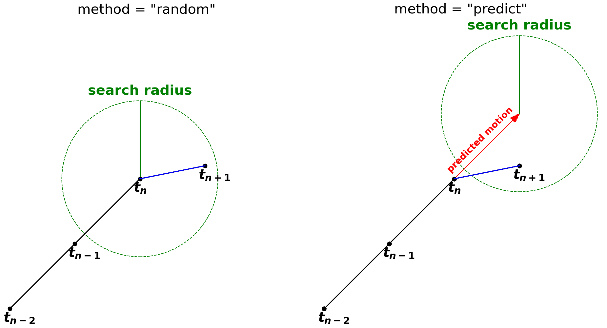
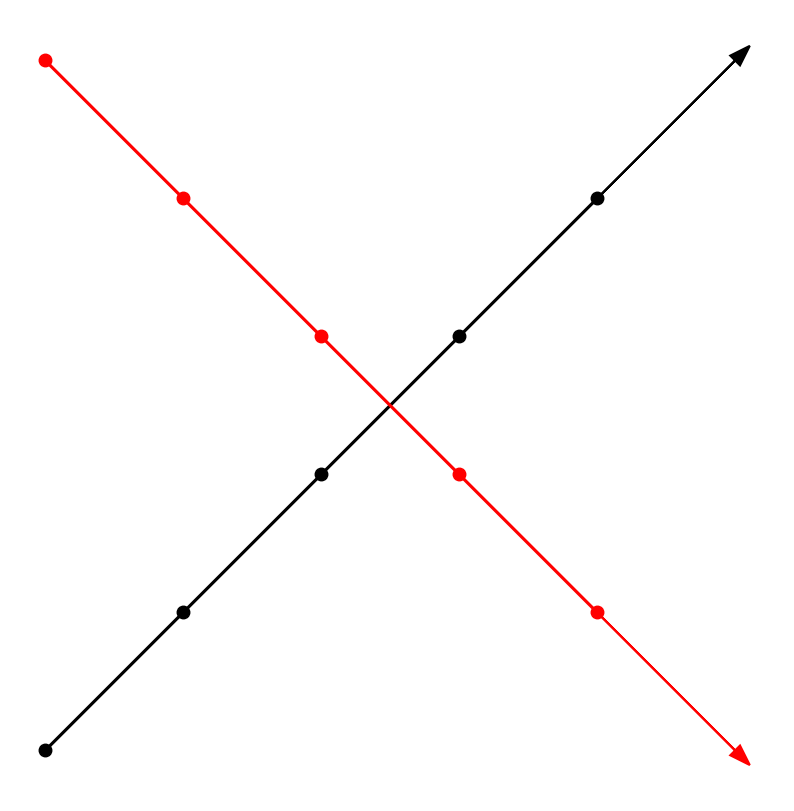
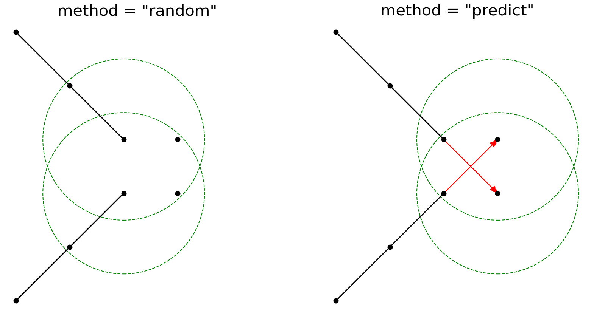
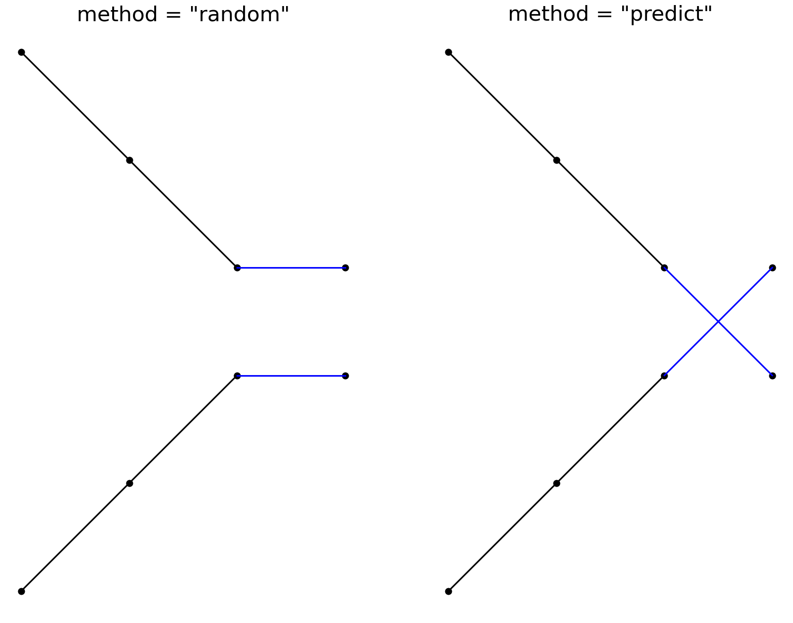

# Tracking Basics

The *tobac* library includes two sets of linking methods, used to track `cells` which consist of multiple `features` over time. These consists of centroid-based methods, which utilise the feature position to link features based on proximity, and overlap-based methods which utilise the segmentation masks produced by feature detection or segmentation to link features according to their spatial overlap across time steps. In general, centroid-based methods work better for smaller, point-like features such as convective updrafts, whereas overlap-based methods work better for larger, more irregularly shaped objects like anvil clouds. However, the most suitable method for any situation may vary, and we recommend that the user experiment with different methods and parameters to find the best solution for their use.

## Centroid-based tracking

The `linking_trackpy` and `linking_trackpy_latlon` methods in *tobac* uses the trackpy library (http://soft-matter.github.io/trackpy). 

This approach only takes the point-like position of the feature, e.g. determined as the weighted mean (see also {doc}`/userguide/feature_detection/index` for information on selecting the appropriate centroid method), into account. Features to link with are looked for in a search radius defined by the parameters v_max or d_max. The position of the center of this search radius is determined by the method keyword. method="random" uses the position of the current feature ($t_i$), while method="predict" makes use of the information from the linked feature in the previous timestep ($t_{i-1}$) to predict the next position. For a simple case the search radii of the two methods look like this:



If there is only one feature in the search radius, the linking can happen immediately. If there are none, the track ends at this timestep. If there are more options, trackpy performs a decision process. Assume there are $N$ features in the current and also $N$ in the next timeframe and they are all within each search radius. This means there are $N!$ options for linking. Each of these options means that $N$ distances between the center of the search radius of a current feature and a feature from the next time frame $\delta_n, n=1, 2, ..., N$ are traveled by the features. Trackpy will calculate the sum of the squared distances

```{math}
\sum_{n=1}^{N} \delta_n^2.
```

For every option the lowest value of this sum is used for linking. As an example, consider these two crossing features:



If the search radius is chosen large enough, each will contain two options, a horizontal and a diagonal feature:



The linking will look differently for both methods in the end. The horizontal features are closer to the current position than the diagonal ones. This is why these are linked by the "random"-method. On the other hand, the diagonal features lie exactly on the guessed positions for the "predict"-method. This means, that the sum of squared distances is 0, and they are the optimal decision for linking in this case:



## Overlap-based tracking

In addition to the centroid-based linking described above, *tobac* offers an alternative tracking method, {func}`tobac.tracking.linking_overlap`, that links features based on the **spatial overlap of their full areal extent** rather than only their point-like positions. For this, a labeled mask of the features over time is required in addition to the features themselves, e.g. the label output of feature detection (`return_labels=True`) or the mask from segmentation, where each grid cell belonging to a feature is labeled with that feature's ID. For each pair of consecutive timesteps, the overlap between every feature in the current timestep and the features in the next timestep is computed, and a one-to-one assignment that maximizes the total overlap area is chosen, which allows e.g. two crossing features to be told apart. Optionally, the feature positions used for computing the overlap can be translated to the next timestep based on the tracked velocities of the features. See {doc}`/userguide/tracking/overlap_tracking` for a detailed description of the parameters and output of overlap tracking.
